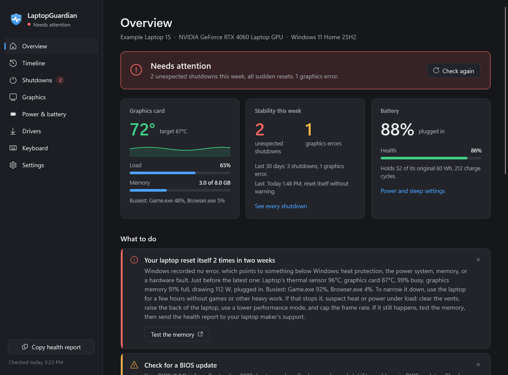
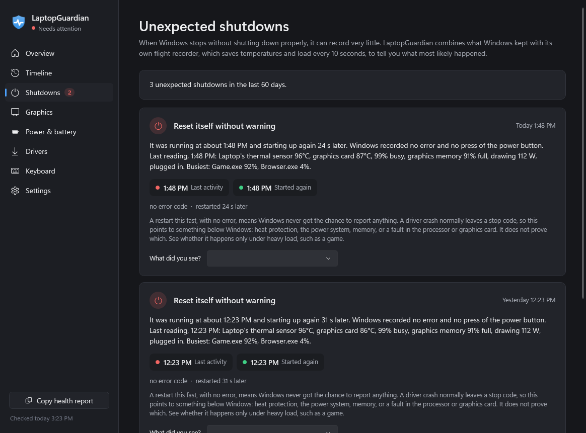
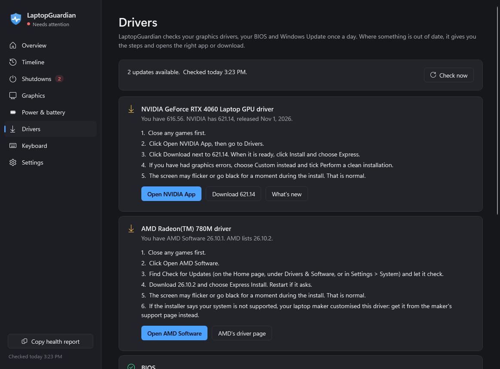

<p align="center"></p>

<h1 align="center">LaptopGuardian</h1>

<p align="center">
Tells you, in plain English, why your Windows laptop crashed or froze, and walks you through updating its drivers.
</p>

<p align="center">
<a href="https://github.com/Deaeath/LaptopGuardian/releases/latest"></a>
<a href="https://github.com/Deaeath/LaptopGuardian/actions/workflows/ci.yml"></a>
<a href="LICENSE"></a>
</p>

<picture>
  <source media="(prefers-color-scheme: light)" srcset="docs/screenshots/overview-light.png">
  
</picture>

Windows records much of what goes wrong, but scatters it across the event log, Windows Error Reporting and the power settings. Much of it is unreadable ("The description for Event ID 153 from source nvlddmkm cannot be found") or misleading: one crash report Windows cannot send is logged again every four hours, so Reliability Monitor can show thousands of "hardware errors" that are really four. And after a sudden reset, Windows may record nothing useful at all.

LaptopGuardian reads what there is, keeps its own record, and explains each event once.

## Install

1. Download **[LaptopGuardian.exe](https://github.com/Deaeath/LaptopGuardian/releases/latest/download/LaptopGuardian.exe)**.
2. Run it. It needs no administrator rights and no .NET install. It installs itself for your user account, adds itself to the Start menu and the notification area, and starts when you sign in. You can turn that off in Settings.

**Windows may warn you the first time.** The program is not code-signed yet, so SmartScreen can show "Windows protected your PC". Choose **More info**, then **Run anyway**. You can [check the download](#check-the-download) first if you like.

**It updates itself.** It checks for new releases twice a day, verifies the download, and restarts quietly in the background when its window is closed. You can turn this off in Settings.

**To remove it,** use Windows Settings > Apps > Installed apps > LaptopGuardian > Uninstall. Your history stays in `%APPDATA%\LaptopGuardian`; delete that folder if you want it gone too.

Requires 64-bit Windows 10 (version 1809 or newer) or Windows 11. So far it has been tested on one Windows 11 laptop with NVIDIA and AMD graphics. Reports from other hardware are very welcome: [report a problem](https://github.com/Deaeath/LaptopGuardian/issues/new/choose).

## What it does

### Explains crashes


It tells apart a sudden reset, a laptop that would not wake, a freeze, a blue screen (with the stop code in words) and an empty battery. It says only what the record supports, and says so when the record cannot tell.

**The flight recorder** saves temperatures, load, power and the busiest apps every 10 seconds, straight to disk. Windows often keeps nothing about a sudden reset, so this is what shows when the laptop stopped and what it was doing. It stays on your PC and uses at most 2 MB.

### Walks you through driver updates


Once a day it compares your drivers with the newest available, then gives you numbered steps, exact links, and a button that opens the right app.

| What | How it checks | What it opens |
|---|---|---|
| NVIDIA graphics | NVIDIA's driver list, for your card | NVIDIA App or GeForce Experience, or the download itself |
| AMD graphics | AMD's driver site, against your AMD Software version | AMD Software, or AMD's page for your product |
| Intel graphics | Intel's own checker compares it for you | Intel Driver & Support Assistant, or Intel's checker |
| BIOS | ASUS's list, for your model. Other makers: you check with their tools | MyASUS, Armoury Crate, HP, Dell, Lenovo, Acer or MSI apps, or the maker's support page |
| Everything else | Windows Update's driver catalog | One-click install, or Windows Update |

It also lists devices with driver problems, in words.

### And the rest
- **Decodes graphics and hardware errors** as they happen (NVIDIA, AMD, Intel, display-driver resets, WHEA), with what the graphics card was doing at that moment.
- **Cuts through Windows Error Reporting noise.** It shows how many real events there were, and can clear the stuck queue so Windows stops logging them again.
- **Watches the graphics card live**: temperature against the driver's own target, load, memory and power. It warns when the card stays at its limit or runs out of memory, and it does not wake a sleeping graphics card to do so.
- **Checks power and battery**: battery wear, sleep type, and sleep, hibernate and lid settings across every power plan.
- **Filters keyboard chatter** for keyboards that type letters twice.
- **Exports a health report** to send to your laptop maker's support.

## Privacy

Your data stays on your PC, in `%APPDATA%\LaptopGuardian`. There are no accounts and no telemetry. The app contacts the internet only to check for updates:

| Service | Why | What it learns |
|---|---|---|
| GitHub | New versions of LaptopGuardian | That a copy is checking |
| NVIDIA | Newest driver (NVIDIA cards only) | Your graphics card's model |
| AMD | Newest driver (AMD graphics only) | Your processor or graphics model, in the page it asks for |
| Microsoft Windows Update | Driver updates | What Windows Update normally learns |
| ASUS | Newest BIOS (ASUS laptops only) | Your laptop's model |

Links and apps open only when you click them.

## Check the download

Every release is built by GitHub Actions from the tagged source, not on anyone's PC. Its notes list the file's SHA-256 hash, and with the [GitHub CLI](https://cli.github.com/) you can confirm where it came from:

```
gh attestation verify LaptopGuardian.exe --repo Deaeath/LaptopGuardian
```

Installed copies check the same hash before they update. That catches a damaged download; the build attestation is what ties the file to this source. See [SECURITY.md](SECURITY.md).

## Build from source

Needs the .NET 10 SDK.

```powershell
dotnet test src\LaptopGuardian.Tests
.\publish.ps1 -Install       # test, build a self-contained exe, install it
```

`LaptopGuardian.exe --diagnose --out report.md` runs a full scan without the window. `--screenshot <folder> [--dark|--light] [--sample] [--viewport]` renders every page to PNG off-screen; `--sample` uses the made-up data shown above.

To release: raise the version in `src/Directory.Build.props`, add it to [CHANGELOG.md](CHANGELOG.md), commit, push, then push a tag `v<version>`.

- `src/LaptopGuardian.Core`: everything that reads Windows and decides what it means. No UI.
- `src/LaptopGuardian`: the WPF app: window, tray icon, notifications.
- `src/LaptopGuardian.Tests`: xUnit tests, including regression tests named after the bugs they pin down.

## Design notes

- **Say only what the record supports.** A power-button timestamp means the button was pressed, not held. "Suspend" rows in the battery report are gaps around restarts, not sleep: reading them as sleep made 2.1.0 wrongly report crashes as "asleep". Asleep now comes only from Windows' own sleep events and crash record.
- **Never announce something old.** `EventLog.EntryWritten` can re-raise old entries once the System log is full. LaptopGuardian subscribes with `EventLogWatcher`, records each event once, and announces only what was written in the last few minutes.
- **Do not cost what you watch.** Measured idle in the tray on 2.0: about 50 MB of memory and under 1% of one CPU core.

## License

[MIT](LICENSE)
